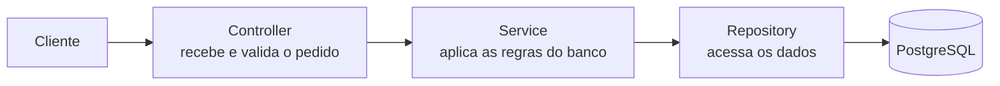
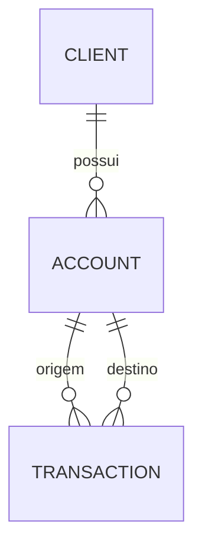

# Fulls Bank - API de um banco digital

[](https://github.com/VictorCharro/fulls-bank-java-spring/actions/workflows/ci.yml)

Projeto de estudo que simula o funcionamento básico de um banco, feito em Java com Spring Boot. A API permite cadastrar clientes, abrir contas e movimentar dinheiro (depósito, saque e transferência), com login e controle de acesso.

A documentação completa (arquitetura, API, regras, erros, testes e planejamento) está na pasta [`docs/`](docs/README.md).

---

## O que a API faz

### Login e acesso
- Cadastro (`POST /auth/register`) e login (`POST /auth/login`) com e-mail e senha. A senha é guardada de forma segura, nunca em texto puro.
- O login devolve um token, que deve ser enviado no cabeçalho `Authorization: Bearer <token>` nas demais chamadas.
- Existem dois perfis: usuário comum e administrador. Só o administrador pode excluir registros e ver as listas completas de clientes e transações.
- Sem token ou com token inválido a API responde `401`. Sem permissão, responde `403`.

### Clientes
- Criar, listar, buscar, atualizar (nome e sobrenome) e excluir clientes, em `/client`.
- O CPF é validado de verdade (dígitos verificadores) e não pode se repetir. Pode ser enviado com ou sem pontos e traço.
- Um cliente que já tem contas não pode ser excluído.

### Contas
- Abrir conta corrente, poupança ou salário, ligada a um cliente. O número da conta (6 dígitos) é gerado automaticamente e o saldo começa em zero.
- Buscar conta pelo ID ou pelo número, e excluir conta (`/account`).
- Uma conta que já tem transações não pode ser excluída.

### Extrato
- `GET /account/{id}/statement` mostra as movimentações da conta, da mais recente para a mais antiga.
- Dá para filtrar por período (`from` e `to`, no formato `2026-03-31`) e navegar por páginas (`page` e `size`; padrão de 20 por página, máximo de 100).

### Transações
- Depósito, saque e transferência entre contas, todos em `POST /transaction`. O saldo é atualizado e a movimentação fica registrada.
- O valor precisa ser maior que zero, e o saque ou a transferência exigem saldo suficiente.
- Se qualquer regra falhar, nenhum saldo é alterado.
- Se duas operações mexerem na mesma conta ao mesmo tempo, uma delas recebe `409` e basta repetir. Isso evita perder dinheiro por conflito.

Exemplos de corpo da requisição:

```json
{ "type": "DEPOSIT", "receiverId": 1, "amount": 100.00 }
```

```json
{ "type": "WITHDRAWAL", "senderId": 1, "amount": 30.00 }
```

```json
{ "type": "TRANSFER", "senderId": 1, "receiverId": 2, "amount": 50.00 }
```

No depósito é preciso informar a conta de destino (`receiverId`), no saque a de origem (`senderId`) e na transferência as duas.

---

## Respostas de erro

Todo erro volta em um formato único, com uma mensagem clara, o código HTTP e o horário.

| Situação | Código |
|---|---|
| Cliente, conta ou transação não encontrados | 404 |
| Dados inválidos, CPF repetido, e-mail já cadastrado, saldo insuficiente, valor inválido, transferência para a mesma conta | 400 |
| Sem login, ou e-mail e senha errados | 401 |
| Sem permissão para a operação | 403 |
| Exclusão bloqueada (cliente com contas, conta com transações) ou conta alterada por outra operação ao mesmo tempo | 409 |
| Não foi possível gerar um número de conta livre (tente de novo) | 503 |

---

## Como o projeto é organizado

Cada pedido passa por camadas, cada uma com uma função:



Relação entre os dados:



Pastas principais, dentro de `src/main/java`:

- `controllers/`: as rotas da API
- `services/`: as regras de negócio
- `repositories/`: o acesso ao banco de dados
- `entities/`: as tabelas (cliente, conta, transação, usuário)
- `dto/`: os formatos dos dados que entram e saem da API
- `mappers/`: a conversão entre entidades e dados de resposta
- `validation/`: validações próprias, como a do CPF
- `security/`: login, token e permissões
- `exceptions/`: os erros e as mensagens

Mais detalhes em [`docs/02-arquitetura.md`](docs/02-arquitetura.md) e [`docs/03-dominio.md`](docs/03-dominio.md).

---

## Tecnologias

- Java 21 e Spring Boot
- PostgreSQL (banco de dados) com Flyway (controle das mudanças no banco)
- Spring Security com token JWT (login)
- Swagger (documentação interativa da API)
- Docker e Docker Compose
- JUnit, Mockito e Testcontainers (testes)
- GitHub Actions (verificação automática a cada alteração)

---

## Como rodar

Há dois caminhos. O mais simples é o Docker.

### Opção 1: com Docker

Precisa só do Docker instalado.

```bash
git clone https://github.com/VictorCharro/fulls-bank-java-spring.git
cd fulls-bank-java-spring
cp .env.example .env
```

Abra o arquivo `.env` e preencha duas coisas:

- `DB_PASSWORD`: uma senha qualquer para o banco
- `JWT_SECRET`: uma chave secreta longa (pelo menos 32 caracteres). Para gerar uma: `openssl rand -base64 48`

Depois suba tudo:

```bash
docker compose up --build
```

A API fica em `http://localhost:8080`. Para parar e apagar os dados: `docker compose down -v`.

### Opção 2: sem Docker

Precisa do Java 21 e de um PostgreSQL com um banco chamado `fulls_bank`.

```bash
export DB_PASSWORD='senha-do-seu-postgres'
export JWT_SECRET="$(openssl rand -base64 48)"
./mvnw spring-boot:run
```

As tabelas são criadas sozinhas na primeira execução.

### Variáveis de configuração

| Variável | Para que serve | Padrão |
|---|---|---|
| `DB_PASSWORD` | senha do banco | obrigatória |
| `JWT_SECRET` | chave secreta dos tokens, com pelo menos 32 caracteres | obrigatória |
| `DB_USER` | usuário do banco | `postgres` |
| `DB_URL` | endereço do banco | `jdbc:postgresql://localhost:5432/fulls_bank` |
| `JWT_EXPIRATION_MINUTES` | por quantos minutos o token vale | `60` |
| `ADMIN_EMAIL` e `ADMIN_PASSWORD` | criam o primeiro administrador ao iniciar (opcionais) | vazias |

Nunca coloque senhas dentro do código nem suba o arquivo `.env` para o GitHub (ele já está ignorado pelo Git).

### Testando a API

Com a API rodando, abra **http://localhost:8080/swagger-ui.html**. Faça login em `POST /auth/login`, clique em **Authorize**, cole o token e teste as rotas pelo navegador.

Pelo terminal:

```bash
curl -X POST localhost:8080/auth/register -H 'Content-Type: application/json' \
  -d '{"email":"ana@example.com","password":"senha-forte-123"}'

TOKEN=$(curl -s -X POST localhost:8080/auth/login -H 'Content-Type: application/json' \
  -d '{"email":"ana@example.com","password":"senha-forte-123"}' | jq -r .accessToken)

curl localhost:8080/transaction/1 -H "Authorization: Bearer $TOKEN"
```

Para saber se a API está de pé: `GET /actuator/health`.

---

## Testes

```bash
./mvnw test
```

Os testes cobrem as regras de cada parte, o login e as permissões, o fluxo completo (cliente, conta, depósito, saque e transferência), as respostas de erro e o caso de várias operações simultâneas na mesma conta. Eles usam um banco PostgreSQL temporário, por isso o Docker precisa estar aberto, mas não é preciso instalar o PostgreSQL.

A cada alteração enviada ao GitHub, o CI roda os testes e também sobe a aplicação com Docker para conferir que ela inicia.

---

## Próximos passos

- Publicar a API na AWS, com banco gerenciado e monitoramento.
- Ligar cada usuário ao seu cliente, para que cada pessoa só enxergue as próprias contas (hoje qualquer usuário logado consulta qualquer conta).

O planejamento completo está nas [issues](https://github.com/VictorCharro/fulls-bank-java-spring/issues) e no [roadmap](docs/10-roadmap.md).
