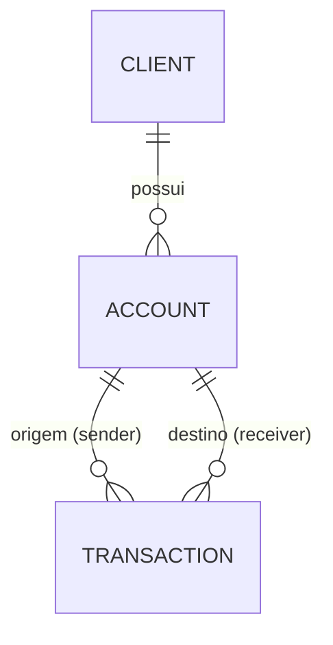

# 🏦 Fulls Bank - API REST com Spring Boot

[](https://github.com/VictorCharro/fulls-bank-java-spring/actions/workflows/ci.yml)

Este é um projeto de estudo que simula um sistema bancário básico, desenvolvido em Java com Spring Boot. A aplicação permite o cadastro e gerenciamento de clientes, contas bancárias e transações financeiras, com foco em boas práticas de back-end corporativo.

📚 A documentação técnica completa (arquitetura, API, regras de negócio, erros, testes e roadmap) está em [`docs/`](docs/README.md).

---

## 🚀 Funcionalidades implementadas

### 👤 Cliente
- Criar cliente (`POST /client`)
- Listar todos os clientes (`GET /client`)
- Buscar cliente por ID (`GET /client/{id}`)
- Atualizar nome e sobrenome (`PUT /client/{id}`); o CPF não é alterado
- Excluir cliente (`DELETE /client/{id}`); bloqueado com `409` se o cliente tiver contas
- Validação de CPF único (11 caracteres)
- Validação com Jakarta Bean Validation (`@Valid`, `@NotBlank`, `@Size`)

---

### 💳 Conta
- Criar conta (corrente, poupança ou salário) com número de 6 dígitos gerado automaticamente (`POST /account`)
- Buscar conta por ID (`GET /account/{id}`)
- Buscar conta por número da conta (`GET /account/number/{number}`)
- Excluir conta (`DELETE /account/{id}`); bloqueado com `409` se a conta tiver transações
- A conta nasce com saldo zero e é associada a um cliente existente (via ID)
- Uso de DTOs (Request/Response)
- Evita laços infinitos de serialização (loop) nas respostas com transações

---

### 🔄 Transações
- **Depósito, saque e transferência entre contas**, todos por `POST /transaction`, com saldo atualizado e a transação registrada automaticamente
- Valor sempre validado: nulo, zero ou negativo retorna `400`
- Operação atômica: se uma regra falhar, nenhum saldo é alterado (`@Transactional`)
- Buscar transação por ID (`GET /transaction/{id}`)
- Listar todas as transações (`GET /transaction`)

Exemplos de corpo:

Depósito:

```json
{ "type": "DEPOSIT", "receiverId": 1, "amount": 100.00 }
```

Saque:

```json
{ "type": "WITHDRAWAL", "senderId": 1, "amount": 30.00 }
```

Transferência:

```json
{ "type": "TRANSFER", "senderId": 1, "receiverId": 2, "amount": 50.00 }
```

---

## ❌ Tratamento de exceções

Tratamento centralizado com `@RestControllerAdvice` e `@ExceptionHandler`, retornando mensagem amigável, HTTP status adequado e timestamp:

| Exceção | Status |
|---|---|
| `ClientNotFound`, `AccountNotFound`, `IdNotFound`, `TransactionNotFound` | 404 |
| `ExistingAccount` (CPF já cadastrado), `InsufficientBalance`, `InvalidAmount`, `SameAccountTransfer` | 400 |
| `MethodArgumentNotValidException` (falha de `@Valid`) | 400 |
| `ResourceInUse` (excluir cliente com contas ou conta com transações) | 409 |
| `AccountNumberUnavailable` (sem número de conta livre) | 503 |

---

## 🏗️ Arquitetura

Aplicação em camadas. O `GlobalExceptionHandler` converte as exceções de negócio em respostas HTTP.

```mermaid
flowchart LR
    A[Cliente HTTP] --> B[Controller<br/>@Valid + DTOs]
    B --> C[Service<br/>regras de negócio<br/>@Transactional]
    C --> D[Repository<br/>Spring Data JPA]
    D --> E[(PostgreSQL)]
    C -. exceções .-> F[GlobalExceptionHandler]
    F -. resposta de erro .-> A
```

Modelo de dados:



Mais detalhes em [`docs/02-arquitetura.md`](docs/02-arquitetura.md) e [`docs/03-dominio.md`](docs/03-dominio.md).

---

## 🛠️ Tecnologias utilizadas

- Java 21 (LTS)
- Spring Boot
- Spring Data JPA
- Hibernate
- Lombok
- Jakarta Bean Validation
- PostgreSQL (banco de dados)
- Maven
- JUnit 5, Mockito e MockMvc (testes)
- GitHub Actions (CI)

---

## 📁 Estrutura de pacotes

- `entities/` → Entidades JPA: `Client`, `Account`, `Transaction`
- `controllers/` → Endpoints REST
- `services/` → Regras de negócio (camada de serviço)
- `repositories/` → Interfaces de persistência
- `dto/` → Objetos de transferência de dados (Request/Response)
- `exceptions/` → Exceções customizadas e handler global
- `enums/` → Enumerações para tipo de conta e tipo de transação

---

## 🔧 Como rodar o projeto

**Pré-requisitos:** JDK 21 e um PostgreSQL local com o banco `fulls_bank` criado.

1. **Clone o repositório:**

```bash
git clone https://github.com/VictorCharro/fulls-bank-java-spring.git
cd fulls-bank-java-spring
```

2. **Crie o banco:**

```sql
CREATE DATABASE fulls_bank;
```

3. **Confira a conexão** em `src/main/resources/application.properties` (URL, usuário e senha do seu PostgreSQL). As tabelas são criadas automaticamente na primeira execução. A leitura desses dados por variáveis de ambiente está planejada na issue [#8](https://github.com/VictorCharro/fulls-bank-java-spring/issues/8).

4. **Suba a API:**

```bash
./mvnw spring-boot:run
```

A API fica disponível em `http://localhost:8080`.

---

## 🧪 Testes

```bash
./mvnw test
```

- Testes unitários dos serviços (JUnit 5 e Mockito) e testes de camada web dos controllers (`@WebMvcTest`).
- `FullsBankApplicationTests` carrega o contexto completo e exige o PostgreSQL rodando (a issue [#11](https://github.com/VictorCharro/fulls-bank-java-spring/issues/11) troca isso por Testcontainers).
- O CI (GitHub Actions) roda `./mvnw verify` em cada push e pull request, com um PostgreSQL de serviço.

---

## 📌 Próximos passos

O planejamento completo está nas [issues](https://github.com/VictorCharro/fulls-bank-java-spring/issues) e no [roadmap](docs/10-roadmap.md). Em resumo:

- 🔑 Segredos fora do código, perfis `dev`/`test` e migrations com Flyway
- 🧪 Testcontainers e testes de integração dos controllers
- 🔒 Lock otimista (`@Version`) e teste de concorrência para saque e transferência
- 🔐 Autenticação com Spring Security e JWT
- 📊 Extrato com filtro por data e paginação
- 📄 Documentação com Swagger/OpenAPI
- 🧠 Mapeamento de DTOs com MapStruct
- 🐳 Docker e docker-compose, e deploy na AWS (RDS, CloudWatch)
