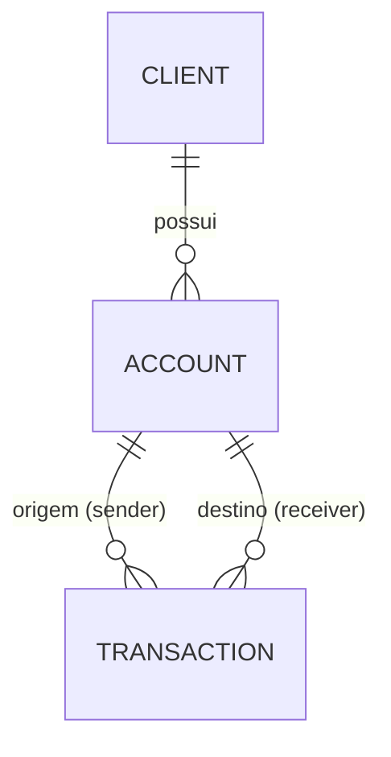

# 🏦 Fulls Bank - API REST com Spring Boot

[](https://github.com/VictorCharro/fulls-bank-java-spring/actions/workflows/ci.yml)

Este é um projeto de estudo que simula um sistema bancário básico, desenvolvido em Java com Spring Boot. A aplicação permite o cadastro e gerenciamento de clientes, contas bancárias e transações financeiras, com foco em boas práticas de back-end corporativo.

📚 A documentação técnica completa (arquitetura, API, regras de negócio, erros, testes e roadmap) está em [`docs/`](docs/README.md).

---

## 🚀 Funcionalidades implementadas

### 👤 Cliente
- Criar cliente (`POST /client`)
- Listar todos os clientes (`GET /client`)
- Buscar cliente por ID (`GET /client/{id}`)
- Atualizar nome e sobrenome (`PUT /client/{id}`); o CPF não é alterado
- Excluir cliente (`DELETE /client/{id}`); bloqueado com `409` se o cliente tiver contas
- Validação de CPF (dígitos verificadores, aceita máscara) e unicidade
- Validação com Jakarta Bean Validation (`@Valid`, `@NotBlank`, `@Size`)

---

### 🔐 Autenticação
- Cadastro (`POST /auth/register`) e login (`POST /auth/login`) com e-mail e senha; a senha é guardada com hash BCrypt
- O login devolve um JWT (HS256) que vai no cabeçalho `Authorization: Bearer <token>`
- Papéis `USER` e `ADMIN`: todo `DELETE` e as listagens globais (`GET /client`, `GET /transaction`) são só do `ADMIN`
- `401` (sem token ou token inválido) e `403` (sem permissão) no mesmo formato de erro da API

---

### 💳 Conta
- Criar conta (corrente, poupança ou salário) com número de 6 dígitos gerado automaticamente (`POST /account`)
- Buscar conta por ID (`GET /account/{id}`)
- Buscar conta por número da conta (`GET /account/number/{number}`)
- Excluir conta (`DELETE /account/{id}`); bloqueado com `409` se a conta tiver transações
- A conta nasce com saldo zero e é associada a um cliente existente (via ID)
- Uso de DTOs (Request/Response)
- Evita laços infinitos de serialização (loop) nas respostas com transações

---

### 📊 Extrato
- `GET /account/{id}/statement`: transações da conta (como origem ou destino), da mais recente para a mais antiga
- Filtro opcional por período (`from` e `to`, datas `yyyy-MM-dd`, inclusivas) e paginação (`page`, `size`; padrão 20, máximo 100)

---

### 🔄 Transações
- **Depósito, saque e transferência entre contas**, todos por `POST /transaction`, com saldo atualizado e a transação registrada automaticamente
- Valor sempre validado: nulo, zero ou negativo retorna `400`
- Operação atômica: se uma regra falhar, nenhum saldo é alterado (`@Transactional`)
- Concorrência: lock otimista (`@Version` em `Account`). Duas operações simultâneas na mesma conta não se sobrescrevem: a segunda a gravar recebe `409` e deve ser repetida
- Buscar transação por ID (`GET /transaction/{id}`)
- Listar todas as transações (`GET /transaction`)

Exemplos de corpo:

Depósito:

```json
{ "type": "DEPOSIT", "receiverId": 1, "amount": 100.00 }
```

Saque:

```json
{ "type": "WITHDRAWAL", "senderId": 1, "amount": 30.00 }
```

Transferência:

```json
{ "type": "TRANSFER", "senderId": 1, "receiverId": 2, "amount": 50.00 }
```

---

## ❌ Tratamento de exceções

Tratamento centralizado com `@RestControllerAdvice` e `@ExceptionHandler`, retornando mensagem amigável, HTTP status adequado e timestamp:

| Exceção | Status |
|---|---|
| `ClientNotFound`, `AccountNotFound`, `IdNotFound`, `TransactionNotFound` | 404 |
| `ExistingAccount` (CPF já cadastrado), `InsufficientBalance`, `InvalidAmount`, `SameAccountTransfer` | 400 |
| `MethodArgumentNotValidException` (falha de `@Valid`) | 400 |
| `EmailAlreadyRegistered` (e-mail já cadastrado) | 400 |
| `InvalidCredentials` (login com e-mail ou senha errados), token ausente ou inválido | 401 |
| Papel sem permissão para o endpoint | 403 |
| `ResourceInUse` (excluir cliente com contas ou conta com transações) | 409 |
| `ConcurrencyFailureException` (conta alterada por outra operação ao mesmo tempo: lock otimista ou deadlock) | 409 |
| `AccountNumberUnavailable` (sem número de conta livre) | 503 |

---

## 🏗️ Arquitetura

Aplicação em camadas. O `GlobalExceptionHandler` converte as exceções de negócio em respostas HTTP.

```mermaid
flowchart LR
    A[Cliente HTTP] --> B[Controller<br/>@Valid + DTOs]
    B --> C[Service<br/>regras de negócio<br/>@Transactional]
    C --> D[Repository<br/>Spring Data JPA]
    D --> E[(PostgreSQL)]
    C -. exceções .-> F[GlobalExceptionHandler]
    F -. resposta de erro .-> A
```

Modelo de dados:



Mais detalhes em [`docs/02-arquitetura.md`](docs/02-arquitetura.md) e [`docs/03-dominio.md`](docs/03-dominio.md).

---

## 🛠️ Tecnologias utilizadas

- Java 21 (LTS)
- Spring Boot
- Spring Data JPA
- Flyway (migrations)
- Spring Security com JWT (OAuth2 Resource Server)
- MapStruct (mapeamento entidade → DTO)
- Swagger/OpenAPI (springdoc)
- Testcontainers
- Hibernate
- Lombok
- Jakarta Bean Validation
- PostgreSQL (banco de dados)
- Maven
- JUnit 5, Mockito e MockMvc (testes)
- GitHub Actions (CI)

---

## 📁 Estrutura de pacotes

- `entities/` → Entidades JPA: `Client`, `Account`, `Transaction`
- `controllers/` → Endpoints REST
- `services/` → Regras de negócio (camada de serviço)
- `repositories/` → Interfaces de persistência
- `dto/` → Objetos de transferência de dados (Request/Response)
- `mappers/` → Conversão entidade → DTO com MapStruct
- `exceptions/` → Exceções customizadas e handler global
- `enums/` → Enumerações para tipo de conta e tipo de transação

---

## 🔧 Como rodar o projeto

**Pré-requisitos:** JDK 21 e um PostgreSQL local com o banco `fulls_bank` criado. Para os testes, Docker em execução.

1. **Clone o repositório:**

```bash
git clone https://github.com/VictorCharro/fulls-bank-java-spring.git
cd fulls-bank-java-spring
```

2. **Crie o banco:**

```sql
CREATE DATABASE fulls_bank;
```

3. **Defina as variáveis de ambiente** da conexão com o banco (a senha não fica no repositório):

| Variável | Uso | Padrão |
|---|---|---|
| `DB_PASSWORD` | senha do PostgreSQL | nenhum (obrigatória) |
| `DB_USER` | usuário | `postgres` |
| `DB_URL` | URL JDBC | `jdbc:postgresql://localhost:5432/fulls_bank` |
| `SPRING_PROFILES_ACTIVE` | perfil ativo: `dev` ou `test` | `dev` |
| `JWT_SECRET` | segredo dos tokens (HS256), mínimo de 32 bytes | nenhum (obrigatória) |
| `JWT_EXPIRATION_MINUTES` | validade do token | `60` |
| `ADMIN_EMAIL`, `ADMIN_PASSWORD` | criam o primeiro administrador na inicialização (opcionais) | vazias |

```bash
export DB_PASSWORD='sua-senha'
export JWT_SECRET="$(openssl rand -base64 48)"
# opcional: cria o primeiro administrador
export ADMIN_EMAIL='admin@example.com' ADMIN_PASSWORD='uma-senha-forte'
```

Perfis: `dev` (padrão) mostra os SQLs no log; `test` é usado pelos testes, com banco em container. As tabelas são criadas pelas migrations do Flyway (`src/main/resources/db/migration`) na primeira execução.

4. **Suba a API:**

```bash
./mvnw spring-boot:run
```

A API fica disponível em `http://localhost:8080`, com a documentação interativa em **`/swagger-ui.html`** (OpenAPI em `/v3/api-docs`): faça login em `POST /auth/login`, clique em **Authorize** e cole o token para testar os endpoints pelo navegador. Exemplo de uso pela linha de comando:

```bash
curl -X POST localhost:8080/auth/register -H 'Content-Type: application/json' \
  -d '{"email":"ana@example.com","password":"senha-forte-123"}'

TOKEN=$(curl -s -X POST localhost:8080/auth/login -H 'Content-Type: application/json' \
  -d '{"email":"ana@example.com","password":"senha-forte-123"}' | jq -r .accessToken)

curl localhost:8080/transaction/1 -H "Authorization: Bearer $TOKEN"
```

### 🐳 Rodando com Docker

Só precisa de Docker (sem JDK nem PostgreSQL local). O `docker compose` sobe a API e um PostgreSQL 16:

```bash
cp .env.example .env   # edite DB_PASSWORD e JWT_SECRET (ex.: openssl rand -base64 48)
docker compose up --build
```

A API fica em `http://localhost:8080` (Swagger em `/swagger-ui.html`) e o healthcheck em `/actuator/health`. Os dados ficam no volume `pgdata`; `docker compose down -v` apaga tudo. O `.env` está no `.gitignore`.

---

## 🧪 Testes

```bash
./mvnw test
```

- Testes unitários dos serviços (JUnit 5 e Mockito) e testes de camada web dos controllers (`@WebMvcTest`).
- Testes de autenticação: cadastro, login, JWT (inválido, expirado, outra chave) e regras por papel.
- Teste de concorrência (threads reais, PostgreSQL real): saques simultâneos e transferências em sentidos opostos nunca perdem atualização.
- Testes de integração dos controllers: fluxo completo (cliente → conta → depósito → saque → transferência) e respostas de erro, com PostgreSQL real em container.
- Os testes que sobem o contexto completo usam um PostgreSQL em container (Testcontainers): precisam de Docker em execução, mas não de PostgreSQL instalado.
- O CI (GitHub Actions) roda `./mvnw verify` em cada push e pull request e, em um segundo job, sobe a aplicação com `docker compose` e consulta `/actuator/health`.

---

## 📌 Próximos passos

O planejamento completo está nas [issues](https://github.com/VictorCharro/fulls-bank-java-spring/issues) e no [roadmap](docs/10-roadmap.md). Em resumo:

- ☁️ Deploy na AWS (RDS, CloudWatch)
